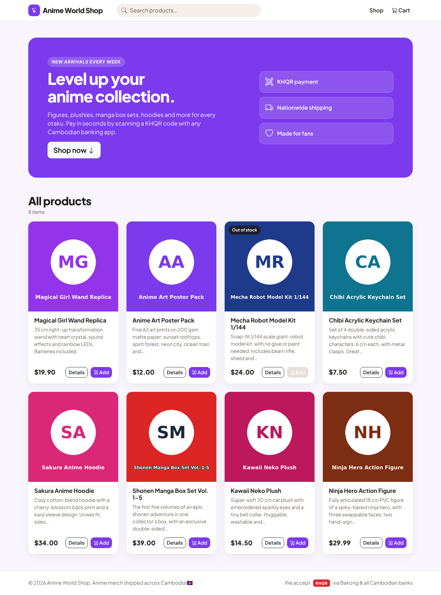

# Anime World Shop: Mini E‑commerce with KHQR Payment

Final project for **Advanced Python Programming (ADV PP)**: a mini anime-merchandise web store (figures, plush, manga, apparel) built with **Python + Flask**.
Customers browse products, manage a cart, and pay by scanning a **Bakong KHQR** code.
Admins manage products and view order history.

> Rename the shop with the `SHOP_NAME` environment variable.



## Features

### Customer (guest) pages
| Page | URL | What it does |
|---|---|---|
| Home | `/` | Product grid with name, price, description, thumbnail; **View Details** and **Add to Cart**; search box |
| Product detail | `/product/<id>` | Full description, price, stock status, image; quantity selector + **Add to Cart**; **Share to Facebook / Telegram** (plus copy link; Open Graph tags give a rich preview) |
| Cart | `/cart` | Items with quantity, unit price, subtotal and total; update quantities or remove items; **Proceed to Checkout** |
| Checkout | `/checkout` | Guest form: Full Name, Email, Phone, Shipping Address (validated) |
| KHQR payment | `/order/<token>/pay` | Dynamic KHQR for the exact amount, 10‑minute countdown, auto‑detects payment every 4 s, regenerate when expired |
| Confirmation | `/order/<token>/confirmation` | Success message, **Order ID**, customer details, items and **Total Amount**; printable receipt |

### Admin pages (`/admin`, login required)
| Page | URL | What it does |
|---|---|---|
| Product list | `/admin/products` | Table: ID, Name, Price, Stock, Status (Active/Inactive); **Add New**, **Edit**, **Delete** |
| Product form | `/admin/products/new`, `/admin/products/<id>/edit` | Name, Description, Price, Stock, Image (upload or URL), Status |
| Order history | `/admin/orders` | Table: Order ID, Customer Name, Phone, Total, Order Date (+ status filter, revenue stats) |
| Order details | `/admin/orders/<id>` | Purchased items, quantities, subtotals, shipping address, KHQR payment info |

Screenshots: [product](docs/screenshots/product.png) · [cart](docs/screenshots/cart.png) · [KHQR payment](docs/screenshots/khqr-payment.png) · [confirmation](docs/screenshots/confirmation.png) · [admin products](docs/screenshots/admin-products.png) · [admin orders](docs/screenshots/admin-orders.png)

## Tech stack
- **Flask 3** (app factory + blueprints), **Flask‑SQLAlchemy** (SQLite locally, PostgreSQL in production)
- **bakong-khqr** to build the EMVCo KHQR string, **qrcode** to render it, **Bakong Open API** (`check_transaction_by_md5`) to confirm payment
- **Pillow** to validate and resize uploaded images (stored in the DB so they survive redeploys)
- **Bootstrap 5** + Bootstrap Icons (bundled in `static/vendor`, no CDN needed)
- **pytest** test suite (14 tests)

## Project structure
```
anime-world-shop/
├── wsgi.py                 # entry point (gunicorn wsgi:app)
├── shop/
│   ├── __init__.py         # create_app(): config, blueprints, filters, CSRF, auto-seed
│   ├── config.py           # settings from environment / .env
│   ├── models.py           # Product, Order, OrderItem
│   ├── cart.py             # session-based cart
│   ├── payments.py         # KHQR generation, Bakong status check, settle order
│   ├── images.py           # upload validation / resize
│   ├── security.py         # CSRF + admin login guard
│   ├── seed.py             # sample products with generated images
│   ├── views/public.py     # customer pages
│   ├── views/admin.py      # admin pages
│   ├── templates/          # Jinja2 templates (shop/, admin/, errors/)
│   └── static/             # css, placeholder image, vendored Bootstrap
├── tests/                  # pytest
├── bakong_proxy/proxy.py   # optional relay for servers outside Cambodia
├── requirements.txt, Procfile, render.yaml, .env.example
```

## Run locally
```bash
python -m venv .venv
```
```bash
source .venv/bin/activate        # Windows: .venv\Scripts\activate
```
```bash
pip install -r requirements.txt
```
```bash
cp .env.example .env             # then edit values
```
```bash
flask --app wsgi run --debug
```
Open http://127.0.0.1:5000. Admin: http://127.0.0.1:5000/admin (default `admin` / `admin123`, **change it**).

The first start creates the database and loads 9 sample products. To reset:
```bash
flask --app wsgi seed --reset
```
Run tests:
```bash
pip install pytest && python -m pytest -q
```

## KHQR payment: how it works
1. At checkout the order is saved as **PENDING** together with its customer details and line items.
2. `payments.assign_new_qr()` builds a **dynamic KHQR** for the exact total with a unique bill number, and stores the QR string, its **MD5**, and an expiry (`QR_TTL_MINUTES`, default 10).
3. The pay page polls `/order/<token>/status`. The server calls Bakong `check_transaction_by_md5`.
4. When Bakong reports the payment, the server checks **amount, currency and receiving account**. It then marks the order **PAID** once only (an atomic conditional update) and decrements stock.
5. The customer is redirected to the confirmation page.

### Modes
- **Demo mode** (default when `BAKONG_TOKEN` is empty): the QR is generated as usual, but payment can't be verified. A *Simulate successful payment* button appears so you can demo the full flow.
- **Live mode**: set `BAKONG_ACCOUNT_ID` (your Bakong account, e.g. `name@aclb`) and `BAKONG_TOKEN` (from https://api-bakong.nbc.gov.kh/register). Scanning with ABA/ACLEDA/Wing/Bakong pays you, and the page confirms by itself.
  - Bakong tokens **expire** periodically. Renew yours on the portal; errorCode 6 means the token expired.
  - Bakong's API **only accepts Cambodian IPs**. If you host abroad (Render, PythonAnywhere…), run `bakong_proxy/proxy.py` on a Cambodian VPS and set `BAKONG_API_URL` + `BAKONG_PROXY_KEY`.

## Deploy (live demo)

### Option A: Render (free, PostgreSQL included)
1. Push this repo to GitHub.
2. On https://render.com choose **New + → Blueprint** and select the repo (it reads `render.yaml`).
3. Fill in the prompted secrets: `ADMIN_PASSWORD`, and optionally `BAKONG_ACCOUNT_ID`, `BAKONG_TOKEN`, `BAKONG_PROXY_KEY`.
4. Your live URL is `https://<service-name>.onrender.com` and the admin is at `/admin`.

> The free Render database expires after 30 days, which is fine for grading. Free web services sleep when idle, so the first request takes about 30 s.

### Option B: PythonAnywhere (free, SQLite persists)
1. In a Bash console: `git clone <repo>`, then `cd anime-world-shop`, then `pip install --user -r requirements.txt`.
2. Web tab → *Add a new web app* → Manual config (Python 3.12) → edit the WSGI file:
   ```python
   import sys; sys.path.insert(0, "/home/<you>/anime-world-shop")
   from wsgi import app as application
   ```
3. Create `/home/<you>/anime-world-shop/.env` (copy `.env.example`), then reload.
4. Static files mapping: URL `/static/` → `/home/<you>/anime-world-shop/shop/static`.

## Security notes
- CSRF token on every form; admin password compared in constant time; session cookie is HttpOnly + SameSite.
- Customer order URLs use a random token, not the sequential ID, so people can't view each other's orders.
- Uploaded images are re‑encoded by Pillow (rejects non‑images, strips metadata, max 1200 px).
- Deleting a product keeps order history (line items keep their name and price).

## Team & contributions
| # | Member | Part |
|---|---|---|
| 1 | _Name_ | Home Page and Product Detail Page |
| 2 | _Name_ | Cart and Checkout |
| 3 | _Name_ | KHQR Payment and Order Confirmation |
| 4 | _Name_ | Admin Products (CRUD) |
| 5 | _Name_ | Admin Order History, Deployment |

## Submission
- **Live Demo:** https://…
- **Admin URL:** https://…/admin, username `…`, password `…`
- **Source Code:** https://github.com/…
- **Video Demo:** https://…
